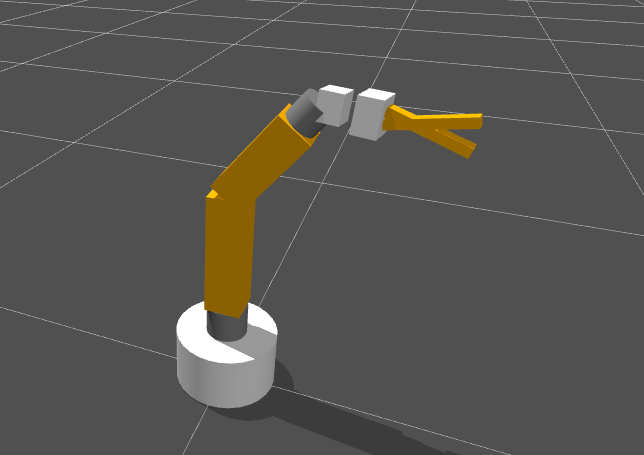
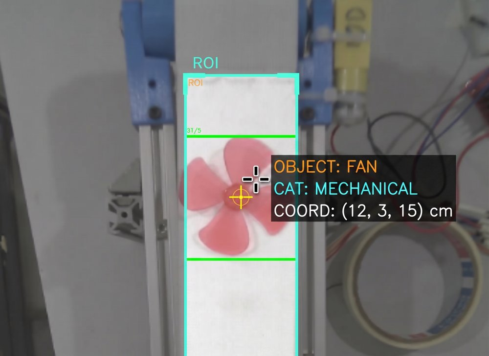
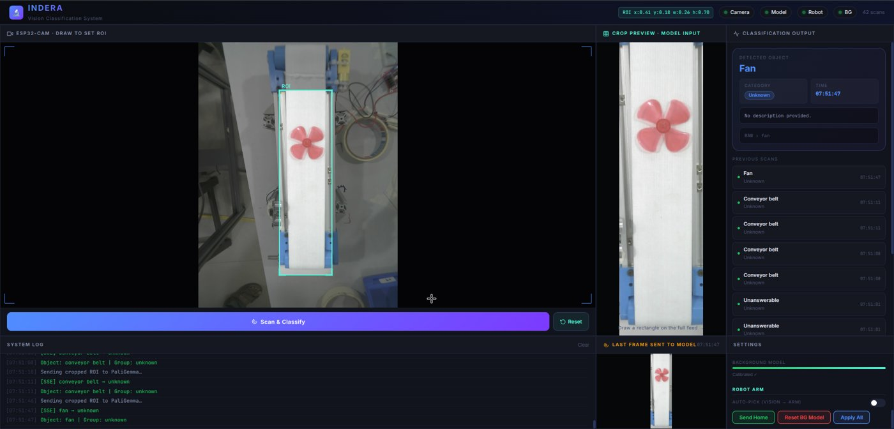

# IndERA-Drishti

A small vision-guided sorting cell: an ESP32-CAM watches a conveyor, PaliGemma (a vision-language model) names what it sees, and a 3D-printed robotic arm is supposed to pick it up and drop it in the right place.


- Demo videos: https://drive.google.com/drive/folders/1P4b91-Dg2tlPtwPfC3rTbewuPNpMdRDS
- Project report: [`IndERA-Drishti.pdf`](IndERA-Drishti.pdf)

Built by Shivam Soni and me (Kartikya Saini) at IIT Bombay, in association with the Digital Enterprise Lab.

## What it is

Industrial sorting arms usually only know a fixed set of parts. We wanted to see how far you could get with a cheap arm plus a general-purpose vision-language model: show it an unknown object (e-waste, hardware, random stuff off a recycling line) and have it pick a bin without training a custom classifier.

The pipeline we aimed for:

1. A conveyor runs until an HC-SR04 ultrasonic sensor sees an object, then stops.
2. The ESP32-CAM frame (cropped to a region of interest) goes to `google/paligemma-3b-mix-224`, prompted to answer with `Object / Group / Description`, where Group is one of 10 inventory bins (ICs, capacitors, resistors, hex nuts, bolts, batteries, tape, USB connectors, jumper wires, unknown).
3. An inverse-kinematics solver turns the pick/place points into joint angles, a Swift-Sim digital twin mirrors the motion, and an Arduino drives the servos.
4. The arm goes home and the belt restarts.

## What I did

**Arm model and IK.** We wrote `custom_arm.urdf` by hand from measurements of the physical arm: 5 revolute joints (base, shoulder, elbow, wrist roll, wrist pitch), each limited to ±90°, plus a gripper on its own servo (the finger joints are `fixed` because roboticstoolbox ignores URDF `<mimic>`). `arm_common.py` wraps roboticstoolbox's Levenberg–Marquardt solver (`ik_LM`, position-only mask, `tol=1e-6`) in a random-restart loop. Each candidate is checked with forward kinematics and rejected if it is off by 10 mm (then 20 mm on re-verification); among the survivors it picks the one with the smallest joint movement and least wrist roll. Servo-side limits are separate from the URDF ones, e.g. the shoulder is capped at 140° because it inverts past that.


*The hand-written URDF of the arm rendered in the Swift simulator, reaching an IK-solved pose (from the project report).*

**Firmware and serial protocol.** `arm_controller/arm_controller.ino` runs on a single Arduino and handles the six servos, the conveyor motor driver and the ultrasonic sensor. The host talks to it over 115200-baud serial: six comma-separated angles for a pose, plus text commands like `HOME`, `CONVEYOR:ON`, `SENSOR:THRESHOLD:N`. The Arduino replies with `DONE:<joint>`, `ALL_DONE`, `OBJECT_DETECTED`, etc. Joints move one at a time in a fixed order (elbow, shoulder, base, wrist roll, wrist pitch, then gripper), 1° per step with a 15 ms delay. That ordering came out of breaking things (see below).

**Vision.** `model_engine.py` loads PaliGemma once (bfloat16, `device_map="auto"`), runs greedy decoding and parses the text reply into a structured result. `app.py` is a Flask dashboard that proxies the ESP32 MJPEG stream, lets you drag a region of interest on the feed, runs inference on a snapshot and pushes results to the page over Server-Sent Events. `model.py` is the earlier Google Colab prototype of the same thing.


*ESP32-CAM frame with the region of interest and PaliGemma's label for a fan on the belt (from the project report).*


*The Flask dashboard: live stream with ROI, the crop sent to the model, classification output and system log (from the project report).*

**Orchestration.** `robot_controller.py` ties the solver, the Swift simulator and the Arduino together. It has a manual mode (`pick x y z`, `home`, `grip:open`) and a `conveyor` mode that checks both pick and place points are reachable before starting the loop.

**Where it ended up.** Honestly: every subsystem worked on its own, but we never got the full loop running end to end. As the report puts it, "we could only build the individual parts but never the complete pipeline". The main blocker was coordinates: a target of (12, 12, 12) in the IK frame landed at roughly (14.8, 8, 12) on the real arm. The code corrects for it with a single rotation about Z (`TABLE_ROTATION_DEG = 17.0` in `arm_common.py`), which is not a properly calibrated transform. On top of that, network latency from the ESP32 plus VLM inference time meant the object had often drifted out of the pick zone by the time the arm moved. We didn't log accuracy or latency numbers, so I can't give you any.


## What I learnt

- **Hardware punishes you for missing software limits.** We burnt out seven servo motors, mostly because the IK solver would sometimes send the arm into stressful poses before we enforced joint limits in code. Clamping angles, moving one joint at a time and ramping slowly all came from that.
- **Small URDF errors add up.** A millimetre off in a link length or joint offset turns into a visible miss at the gripper. Measuring carefully, and checking the URDF against the real arm early, would have saved us days.
- **Frames are the hard part.** We had three coordinate frames (the simulator, the IK solver and the physical arm) and spent far too long working out why they disagreed. Next time I'd put a calibration step (touch known points, fit a transform) in from the start, not patch it with a single angle at the end.
- **IK solvers need guarding.** A converged solution is not necessarily a usable one. Re-checking with FK, restarting from random seeds and scoring by how far the joints move made the solver much more predictable.
- **A zero-shot VLM is easy to start with and hard to rely on.** PaliGemma will happily name objects with no training at all. Getting it to stick to a fixed list of bins depends on the prompt; one bug we fixed was a prompt that let the model invent its own category, which silently ignored the configured groups.
- **Latency is a system property.** Each piece was fine on its own; a camera stream, a 3B-parameter model and a slow sequential arm in series are not. Doing the vision before the belt stops, or tracking the object (`tracker.py` is still a stub), is what I would try next.
- **Integrate early.** We built the parts in parallel and left integration until the end, which is exactly where we ran out of time.

## Repo structure

```
app.py                      Flask dashboard: ESP32 stream proxy, ROI crop, inference, SSE log
model_engine.py             PaliGemma loading, prompting and output parsing (used by app.py)
model.py                    Original Google Colab prototype of the vision step
arm_common.py               Shared config (serial port, limits, pick/place points), URDF loader,
                            coordinate transform, robust IK
robot_controller.py         Arduino + Swift simulator + conveyor automation (manual / conveyor modes)
ik_solver.py                Standalone CLI to test IK for a target point
ik_visualize.py             IK + Swift visualisation without hardware
custom_arm.urdf             Hand-written URDF of the arm
arm_controller/arm_controller.ino   Arduino firmware: servos, conveyor, ultrasonic, serial protocol
stream.py, virt_camera.py   View the ESP32 stream / expose it as a virtual webcam
tracker.py                  Placeholder for object tracking (not implemented)
templates/index.html        Dashboard UI
IndERA-Drishti.pdf          Project report
```

## How to run

**Hardware.** Upload `arm_controller/arm_controller.ino` to the Arduino. Servos go on pins 3, 5, 6, 9, 10, 11; ultrasonic TRIG on 4, ECHO on 2; conveyor driver on 7, 8, 12. Set `SERIAL_PORT` in `arm_common.py` (it is `COM6` on my machine).

**Python setup.**

```bash
pip install -r requirements.txt
pip install roboticstoolbox-python spatialmath-python swift-sim
```

Create a `.env` file in the repo root:

```
HF_TOKEN=your_huggingface_token        # PaliGemma is a gated model
ESP32_STREAM_URL=http://<esp32-ip>:81/stream
```

The dashboard's default stream URL is set in `app.py` and can also be changed at runtime through `POST /settings`.

**Vision dashboard.**

```bash
python app.py
```

Open http://127.0.0.1:5000, draw a region of interest on the feed and click "Scan & Classify".

**Arm control / automation.**

```bash
python robot_controller.py
```

This opens the Swift simulator in the browser and connects to the Arduino. Use manual commands (`pick 15 0 10`, `home`, `grip:open`) or type `conveyor` to start the automatic loop.

**IK without hardware.**

```bash
python ik_visualize.py
```
